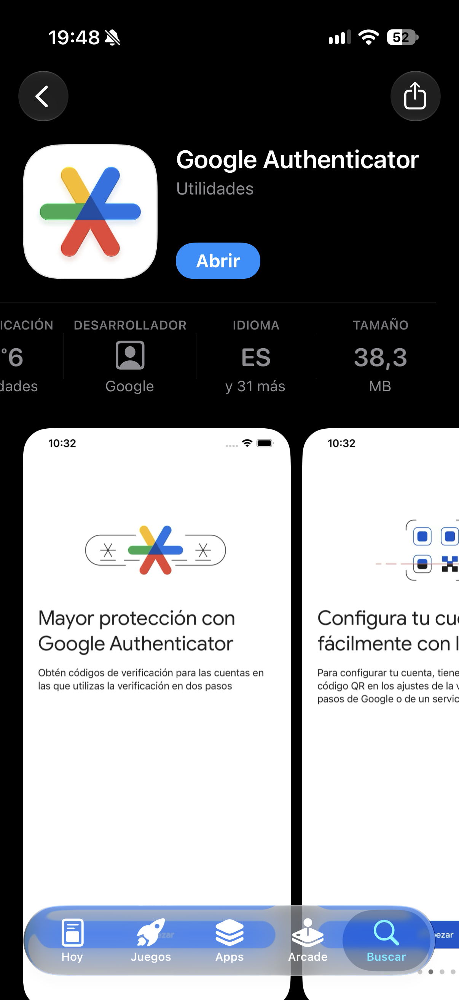

__NF1AA3. Autenticació multifactor (MFA)__

El primer pas serà instal·lar l’app d’autenticació, per aquest exercici usarem Google Authenticator, però funcionaria exactament igual amb qualsevol altra. Trobareu l’app a la botiga d’aplicacions bé sigui d’Android o d’iOS.

